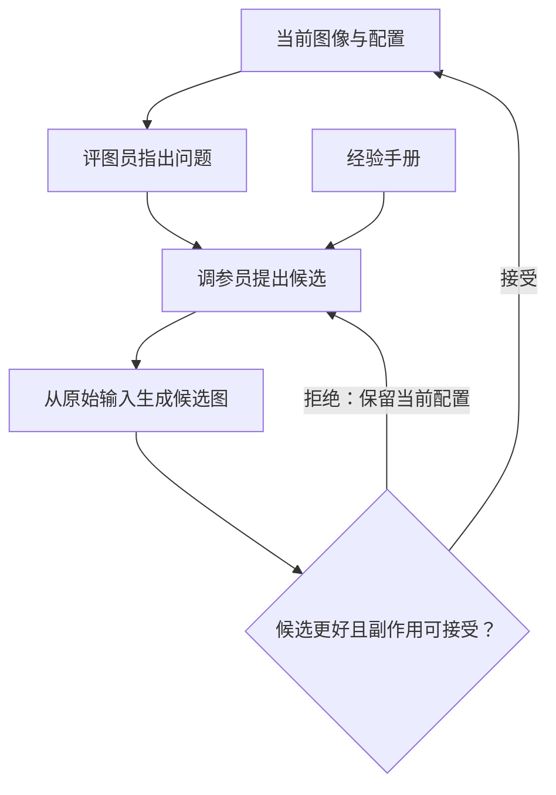

# 01｜通俗入门：看懂车载 ISP 评测微调与自动调参

> **约 10—15 分钟读完。** 这份帮助你理解“为什么做、各模块怎样配合、先学什么”。具体数据、命令和完整代码放在配套的《02_ISP_Agent_技术实现_融合版.md》。先建立框架，再动手。

## 1. 这场讲座，其实讲了两件事

假设你拿到一张夜间道路图：画面偏暗，噪点明显，希望程序自动把它调好。

第一件事是**训练一个会评图的模型**，让它能指出问题，并比较两个版本。第二件事是**设计一个会试错的调参流程**，根据评价决定改什么、是否保留。

整个系统可以看成四个角色：

| 角色 | 通俗理解 | 负责什么 |
|---|---|---|
| 评测模型 | 评图员 | 判断问题、程度和 A/B 优劣 |
| 调参 Agent | 调参员 | 提出参数修改，安排试验与停止 |
| ISP 工具 | 图像处理工具 | 按配置真正生成图像 |
| 知识库 | 经验手册 | 提供参数说明与验证过的经验 |

ISP 是相机的图像处理管线，包含白平衡、降噪、锐化等模块。**评测模型判断，Agent 决策，ISP 执行。** 第一版的决策可以先用规则实现，再逐步换成大模型规划。

## 2. 跟着一张夜景图，走完一次调参

下面只是教学例子，不是真实实验结果。

| 尝试 | 观察到什么 | 怎么决定 |
|---|---|---|
| 小幅提亮 | 道路更清楚，但噪声更明显 | 若整体收益值得，先保留 |
| 较强降噪 | 颗粒少了，路面纹理也消失 | 拒绝这次尝试 |
| 较弱降噪 | 噪声减少，细节还能保留 | 接受，再复查其他维度 |

核心循环是：**提出候选 → 生成图像 → 比较 → 接受或拒绝。** “增加降噪应该有效”只是猜想，实际输出才决定结果。

## 3. 怎样设计流程，才能少走弯路？

### 先分阶段，缩小每一步的选择

同时改二十个参数，很难知道哪个修改有效。讲座借鉴修图工作流，把任务分成四个阶段：

| 阶段 | 优先调整 | 防止什么副作用 |
|---|---|---|
| 光影 | 亮度、对比度、曲线 | 高光过曝、噪声显露 |
| 色彩 | 白平衡、色偏、饱和度 | 颜色失真、过饱和 |
| 细节 | 降噪、锐化 | 纹理损失、边缘光晕 |
| 全局复查 | 重新访问有问题的模块 | 前面改善的地方又变差 |

“锁定”是暂时不改，关联问题出现时可以重新开放。这是**优化参数的顺序**，实际 ISP 内部算法仍按平台规定运行。

### 保存完整状态，让每次尝试可撤销

每次都从同一份原始输入重新处理，保存完整配置，包括数值、开关和模式。候选通过检查后，才替换当前配置。

因此，“拒绝”可以直接丢弃候选；之前接受的结果始终保留。只恢复降噪强度，却忘了降噪是否启用，就不一定能恢复原图。

还要规定停止条件：问题已改善、连续尝试没有收益，或调用预算用尽。最终保留通过检查的结果，局部试错不保证全局最优。

### MDP 先这样理解

MDP 是描述连续决策的框架：当前图像和配置是**状态**，参数修改是**动作**，ISP 是**环境**，结果好坏是**反馈**。分阶段体现了层次化决策思想，但不意味着已经训练了强化学习策略。先写规则与回退循环，也能实现这套设计。

## 4. 评图员怎样通过微调变得更专业？

### 第一步：明确它应该回答什么

通用模型可能认得道路和车辆，却未必能稳定判断细微噪声、偏色与锐化光晕。[4](https://arxiv.org/abs/2503.22679) MOS 原本是人的主观评分平均值；模型给出的 MOS 通常是对此类评分的预测。单个总分仍难以指出下一步该改哪里。

因此，需要两类答案：

- **相对比较：**A/B 整体谁更好？亮度、对比度、色偏、饱和度、噪声、清晰度各有什么差异？
- **各自诊断：**A 有轻微噪声，B 明显偏暗；依据出现在什么区域？

“更亮”不等于“亮度更合适”。模型要学习质量判断，给出的文字依据也需要检查。配套实现先输入 A/B 两张图并分别诊断；独立的单图输入任务留到后续扩展。

### 第二步：用专家答案做 SFT

一条训练样本就是：**图像 + 问题 + 专家答案**。先统一“轻微、明显、严重”的标准，再扩充样本；留出未用于训练的场景检验效果。同源图像和相邻帧放在同一组，避免训练与测试内容近乎重复。

**SFT 是监督微调：**模型看图回答，训练程序根据专家答案更新可训练权重，学习判断、术语和输出格式。讲座中的“结论加权”让训练更重视关键结论，第一轮先用普通 SFT。

**LoRA**冻结大部分基础权重，训练少量附加参数，减少相关训练开销。[2](https://arxiv.org/abs/2106.09685) 两者可以同时使用：**SFT 说明怎样学习，LoRA 说明主要更新哪里。**

这里分清三种参数：ISP 配置控制图像；模型权重控制判断；学习率与训练轮数控制训练。调亮图片，不会自动改变模型权重。

### 第三步：按需要用 GRPO 对齐专家偏好

SFT 效果稳定后，再考虑 GRPO。对同一组 A/B 图像与问题生成多份回答，按照专家标签奖励正确的整体、维度和缺陷判断，再利用组内相对表现更新模型。[3](https://arxiv.org/abs/2402.03300)

**A/B 是两张图；GRPO 的“组”是多份评价回答。** 此时奖励衡量“评价是否符合专家”，外层调参反馈衡量“图像是否改善”，两者不要混淆。

笔记中的 Qwen3.5-9B [1](https://huggingface.co/Qwen/Qwen3.5-9B)、900 对专家数据是讲座项目线索，不能直接当成通用最低配置。 技术版先用较小模型练流程；是否需要 GRPO，由独立评测决定。

## 5. 知识库与数据飞轮，分别积累什么？

知识库保存平台指南、人工经验和已核验的 Agent 案例。一条经验至少写清：什么条件、出现什么问题、改了什么、实际效果与副作用。失败案例同样有用。

复盘后，数据走两条路径：

- **已验证的调参经验 → 知识库 → 下次检索。**
- **专家复核的图像标签 → 新一轮训练与验证 → 评测模型更新。**

写入经验增加外部资料，训练才改变模型权重。持续收集分歧与失败、人工复核、改进并检验，就是这里的数据飞轮。

## 6. 按五步动手，每次只完成一件事

| 顺序 | 做什么 | 完成标志与技术版位置 |
|---|---|---|
| 1 | 跑 CPU 图像实验 | 能解释一次接受与拒绝；第 1 节 |
| 2 | 准备标注和固定数据划分 | 标签一致、同源数据不跨集合；第 2 节 |
| 3 | 保存原模型基线，再做 LoRA SFT | 训练可运行，保存后能重载；第 3 节 |
| 4 | 对比微调前后 | 说清哪些判断改善、哪些仍失败；第 4 节 |
| 5 | 接入模型评价的调参循环 | 能接受、拒绝和停止；第 5 节 |

第 6 节 GRPO 和第 7 节知识积累按需要再做。第一次只运行技术版第 1 节，不需要同时准备 GPU 和真实 ISP。

## 7. 五个自检问题

1. **谁判断，谁决策，谁执行？** 评测模型判断，Agent 决策，ISP 执行。
2. **为什么分阶段之后还要复查？** 参数会相互影响，后续修改可能损害之前的改善。
3. **SFT 与 LoRA 能一起用吗？** 能，一个说明怎样训练，一个说明主要更新哪些参数。
4. **为什么候选要从原始输入重新生成？** 输入一致才能公平比较，完整配置才能重现结果。
5. **写入知识库就是微调吗？** 不是，经验可立即检索，模型权重需要训练才会更新。

## 资料入口：第一遍可以跳过

- [1](https://huggingface.co/Qwen/Qwen3.5-9B) [Qwen3.5-9B 官方模型卡](https://huggingface.co/Qwen/Qwen3.5-9B)：讲座记录的基础模型。
- [2](https://arxiv.org/abs/2106.09685) [LoRA 原论文](https://arxiv.org/abs/2106.09685)：参数高效微调。
- [3](https://arxiv.org/abs/2402.03300) [DeepSeekMath 原论文](https://arxiv.org/abs/2402.03300)：GRPO 的原始介绍。
- [4](https://arxiv.org/abs/2503.22679) [Q-Insight 原论文](https://arxiv.org/abs/2503.22679)：图像质量理解与强化学习的相关研究。
