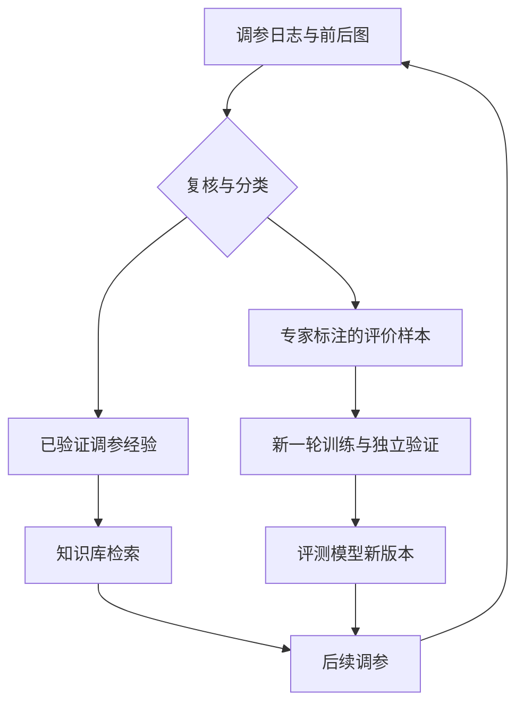

# 02｜技术实现：车载 ISP 评测微调与调参 Agent

> **配套入门文档：`01_ISP_Agent_通俗入门_融合版.md`。** 本手册负责把概念落实为数据、命令、代码与验收步骤。先完成第 1 节，再逐步增加模型和真实工具；完整的 9 个脚本集中在附录 A，可以一次提取。
>
> 统一采用 ms-swift 4.6 路线，先用 Qwen3.5-2B 练习，再按资源迁移到讲座记录的 9B。教学标签、奖励和超参数是可修改的起点。CPU 实验与控制逻辑已验证；GPU 推理、SFT、GRPO 及真实 ISP 尚未实测。接口核查日期：2026-11-12。

## 实施导航

| 本次目标 | 章节 | 完成后应得到什么 |
|---|---|---|
| 第一次动手 | 第 1 节 | 合成输入、处理结果、参数与尝试日志 |
| 准备可训练数据 | 第 2 节 | 固定场景划分、统一标签与训练文件 |
| 做一次微调 | 第 3 节 | 原模型基线、SFT 适配器、重载结果 |
| 检查是否改善 | 第 4 节 | 同条件的验证与最终测试对照 |
| 接成软件闭环 | 第 5 节 | 模型评价参与的接受、拒绝与停止 |
| 按需扩展 | 第 6—7 节 | GRPO 对照和经过复核的经验积累 |

## 0. 先固定项目边界与接口

### 0.1 这一版具体实现什么？

实现静态、同场景 A/B 图像评价，输出整体偏好、六维偏好及两图各自的缺陷；调参按光影、色彩、细节、全局复查组织。已有代码采用**规则提出候选＋模型评价＋RGB 软件处理**。LLM 规划、知识库检索服务与硬件 ISP 是后续替换接口。

“绝对诊断”指针对每张图判断问题类型和程度，不要求输出一个可跨场景比较的绝对 MOS。双图输入中的各自诊断，也不等于已训练独立单图输入任务。

| 图像身份 | 含义 | 为什么要分清 |
|---|---|---|
| `source` | 固定原始输入；演示是 RGB，真实平台可为 RAW/视频 | 每个候选都从它重新处理 |
| A | 当前已接受配置生成的结果 | 是本次比较对象，不自动等于质量真值 |
| B | 候选配置生成的结果 | 通过检查后才能替换当前版本 |
| 可选参考图 | 另外提供、适合该任务的高质量参考 | 仅在参考条件满足时用于 PSNR 等指标 |

### 0.2 三个接口与一套状态

| 接口 | 输入 | 输出 |
|---|---|---|
| `render(source, config)` | 固定输入、完整配置 | 候选图像 |
| `compare(A, B)` | 同场景两个处理结果 | 通过协议检查的评价 |
| `propose(state, diagnosis, knowledge)` | 当前状态、诊断、经验与约束 | 候选配置；演示中由 `proposals` 规则函数承担 |

状态至少保存原始输入、当前配置与输出、阶段入口、初始基线、历史候选和剩余预算。数值参数与开关放进同一份配置，只有接受后才提交。视频接入还需纳入影响输出的时域状态。

### 0.3 文件怎样组织？

| 位置 | 保存什么 |
|---|---|
| 项目根目录 | 本技术 Markdown 与提取出的 Python 脚本 |
| `data/images/`、`data/labels.jsonl` | 自己的图像与专家标注 |
| `data/prepared_v1/` | 固定数据划分；增量时另建 `prepared_v2/` |
| `model_snapshot/`、`runs/model_lock.json` | 固定版本的底座与来源记录 |
| `runs/` | 训练、评测和模型参与的调参实验 |
| `toy_run/` | 首个 CPU 图像实验 |

下面命令按 Linux / WSL 的 Bash 编写。完成每一步的“完成标准”后，再进入下一步。

## 1. 第一个实验：在 CPU 上看见接受与回退

**本步只学习控制流程，不需要 GPU、训练数据或真实相机。** 程序生成一张暗、带噪的合成图，再用 Pillow 做亮度、饱和度、模糊和锐化变换。

将本文保存为 `02_ISP_Agent_技术实现_融合版.md`，放进一个新项目目录。按附录 A 的命令提取脚本；它只生成代码文件，不会自动运行训练。下面所有命令都在同一项目目录执行，采用 Linux / WSL 的 Bash 写法。

```bash
python3 -m venv .venv-demo
source .venv-demo/bin/activate
python -m pip install numpy pillow
python toy_loop.py
```

| 产物 | 你要观察什么 |
|---|---|
| `toy_run/source.png` | 起始合成图像 |
| `toy_run/best.png` | 最终已接受配置生成的图像 |
| `toy_run/best.json` | 完整参数、起始和最终指标 |
| `toy_run/trace.jsonl` | 每个候选、指标、是否符合条件、是否实际提交 |

本次验证运行产生 **60 次候选尝试、12 次配置提交**。分数是人为构造的教学指标；其中高频残差同时包含噪声与纹理，不能据此宣称真实画质或智驾感知效果提升。`ev` 是显示域增益模拟，不是相机曝光时间；Pillow 变换也不能当成完整 RAW ISP。

按这个顺序读附录中的 `toy_loop.py`：`Params` 保存配置 → `render` 生成图像 → `evaluate` 返回教学指标 → `proposals` 提出候选 → `run` 比较并提交。每次从同一份 `source` 重新处理，当前配置只在接受时更新。

**完成标准：**找到一次提交和一次拒绝，能解释原因；确认配置同时保存开关和强度；把预算从 60 改小后，能解释为什么有些阶段来不及完成。再次运行时使用新的输出目录，或先将旧目录改名保存。

到这里，你已经做出一个最小调参控制器。下一步准备数据，把简单评价器逐步换成模型。

## 2. 准备数据：先统一答案，再固定划分

### 2.1 采用一套输出协议

后面的标注、SFT、推理、GRPO 和控制器共用 `schema.py`，避免各模块使用不同字段。

| 字段 | 含义 | 约定 |
|---|---|---|
| `overall` | 整体谁更好 | `A/B/tie/uncertain` |
| `relative` | 六个维度分别谁更好 | 每个维度同上 |
| `absolute` | A、B 各自的缺陷 | 每个维度包含 `issue` 与 `level` |
| `evidence` | 可见的判断依据 | 一句短描述，最多 300 字符 |

`tie` 表示质量相近；`uncertain` 表示不能可靠判断。缺陷程度为 **0 无、1 轻微、2 明显、3 严重**；不可判断用 `issue="unknown", level=null`。没有标注不等于没有问题，不能随意补 `0` 或 `tie`。

| 维度键 | 评价内容 | 问题类型示例 |
|---|---|---|
| `brightness` | 亮度是否合适 | `under` 偏暗、`over` 过亮 |
| `contrast` | 对比度是否合适 | `low` 偏低、`high` 偏高 |
| `color_cast` | 是否存在色偏 | `warm/cool/green/magenta` |
| `saturation` | 饱和度是否合适 | `low/high` |
| `noise` | 噪声是否明显 | `visible` |
| `sharpness` | 细节是否自然清楚 | `blur` 模糊、`oversharpen` 过锐 |

各维度正常时均为 `issue="ok", level=0`。当前每个维度只记录一个主要问题；一张图同时存在不同区域的多种色偏时，应标记为待扩展案例，后续再增加区域级标签。文字依据便于人工检查，但生成理由本身不能证明模型解释忠实。

### 2.2 一条完整样本长什么样？

在 `data/labels.jsonl` 中，每行保存一个对象。下面展开仅为阅读方便，**示例标签没有对应真实图像**；实际训练必须替换为自己的图像和专家标注。图像路径相对于标签文件所在目录。

```json
{
  "id": "scene_001_pair_01",
  "group_id": "drive_01_clip_03",
  "images": ["images/scene_001_A.png", "images/scene_001_B.png"],
  "expert": {
    "overall": "A",
    "relative": {
      "brightness": "A", "contrast": "tie", "color_cast": "tie",
      "saturation": "tie", "noise": "B", "sharpness": "A"
    },
    "absolute": {
      "A": {
        "brightness": {"issue": "ok", "level": 0},
        "contrast": {"issue": "ok", "level": 0},
        "color_cast": {"issue": "ok", "level": 0},
        "saturation": {"issue": "ok", "level": 0},
        "noise": {"issue": "visible", "level": 1},
        "sharpness": {"issue": "ok", "level": 0}
      },
      "B": {
        "brightness": {"issue": "under", "level": 2},
        "contrast": {"issue": "ok", "level": 0},
        "color_cast": {"issue": "ok", "level": 0},
        "saturation": {"issue": "ok", "level": 0},
        "noise": {"issue": "ok", "level": 0},
        "sharpness": {"issue": "blur", "level": 1}
      }
    },
    "evidence": "A 的暗部道路更可辨；B 更平滑，但纹理损失。"
  }
}
```

用 `json.dumps(record, ensure_ascii=False) + "\n"` 写出一条 JSONL。先标注约 20—30 对图，用实际示例统一程度、观察区域及噪声与纹理的取舍，再扩充场景；这个数量只用于检查规范，不是训练有效模型的保证。

标注时隐藏算法来源，随机安排 A/B 位置。交换图像时，要同步交换整体、维度、绝对诊断及文字依据中的 A/B。固定观察尺度，确认缩放后仍能看见目标缺陷；邻近帧和同源裁剪不能跨集合。

### 2.3 固定训练、验证、测试的分组

训练集用于学习，验证集用于选参数和检查点，测试集用于定稿后的最终检验。`group_id` 应覆盖同源 RAW 的不同参数版本和同一拍摄片段的相邻帧；高度重复的跨片段场景也应合并。

首次运行：

```bash
python prepare_data.py --labels data/labels.jsonl --output data/prepared_v1
```

脚本要求至少 10 个独立组，按组近似 80%/10%/10% 划分。10 组只是流程要求，不是模型有效性标准；少量组的结果不稳定。输出目录内包含：

| 文件 | 用途 |
|---|---|
| `train.sft.jsonl`、`val.sft.jsonl`、`test.sft.jsonl` | 图像、问题与标准回答 |
| `train.grpo.jsonl` 等 | 图像、问题及供奖励函数读取的 `solution` |
| `train.audit.jsonl` 等 | ID、分组、图像和专家答案，供独立评测 |
| `split_manifest.json` | 固定分组、样本归属与图像内容哈希 |

新增数据时，提供**包含旧样本和新增样本的累计标签**，显式复用旧清单并输出新版本：

```bash
python prepare_data.py --labels data/labels.jsonl \
  --reuse-manifest data/prepared_v1/split_manifest.json \
  --output data/prepared_v2
```

旧组归属不变，新组只追加到训练集；已有输出目录不会被覆盖。完全重复图像被放入不同组时会报错，近似图像与相邻帧仍需人工分组。**固定比较集还要固定具体样本与标签**：后续最终对照继续使用保留的 `prepared_v1/test.audit.jsonl`；若修订测试标签或扩充测试样本，明确记作新的评测版本。

**完成标准：**能打开全部图像；组之间没有交叉；标签规范一致；各集合有主要场景覆盖；A/B 顺序正确。只有整体标签时，应先设计整体评价任务，不要伪造六维标签来满足协议。多模态训练数据格式依据见资料 [3](https://swift.readthedocs.io/en/v4.6/Customization/Custom-dataset.html)。

## 3. 现成模型基线与第一次 LoRA SFT

### 3.1 准备环境与固定底座

统一使用 **ms-swift 4.6 + LoRA**，先用 Qwen3.5-2B 学流程。独立创建训练环境，按 [PyTorch 官方安装页](https://pytorch.org/get-started/locally/)安装与显卡驱动适配的 PyTorch，再执行：

```bash
python3.12 -m venv .venv-train
source .venv-train/bin/activate
# 先在这个环境中按 PyTorch 官方页面安装 torch，再执行下面的命令。
python -m pip install 'ms-swift==4.6.0' 'transformers>=5.9,<6' 'qwen_vl_utils>=0.0.14' peft pillow numpy huggingface_hub
python -m pip check
python -c "import torch; print('CUDA:', torch.cuda.is_available()); print('BF16:', torch.cuda.is_bf16_supported())"
python lock_model.py
export ISP_BASE_MODEL="$PWD/model_snapshot"
```

`lock_model.py` 将模型提交版本记录到 `runs/model_lock.json`，并下载至 `model_snapshot`。下载中断可重跑，仍使用原提交。后续显式传 `--model "$ISP_BASE_MODEL"`，保持基线、训练与推理使用同一个底座。需要讲座的 9B 时，在新项目目录执行 `MODEL_ID=Qwen/Qwen3.5-9B python lock_model.py`，重新做基线和训练；2B 的适配器不能直接加载到 9B。[1](https://huggingface.co/Qwen/Qwen3.5-2B)[2](https://swift.readthedocs.io/en/v4.6/BestPractices/Qwen3_8-Best-Practice.html)[6](https://huggingface.co/docs/huggingface_hub/guides/download)

命令默认支持 BF16 的 NVIDIA GPU；不支持时改用 `float16` 并先检查数值稳定性。LoRA 不会消除底座权重和图像激活的开销，2B 也不能保证任意显卡可训练。遇到 FLA/GatedDeltaNet 内核依赖问题，按资料 [2](https://swift.readthedocs.io/en/v4.6/BestPractices/Qwen3_8-Best-Practice.html) 的环境章节处理。完成推理、短训练、保存和重载后，再冻结实际成功的依赖版本。

### 3.2 微调前先保存基线

```bash
CUDA_VISIBLE_DEVICES=0 python evaluate_dataset.py \
  --model "$ISP_BASE_MODEL" --data data/prepared_v1/val.audit.jsonl \
  --output runs/eval_base
```

它使用固定提示词和输出协议评测原模型。结果存为 `metrics.json` 与 `predictions.jsonl`，第 4 节解释如何读。先检查少量原始输出与专家标签；模型连基本推理都未跑通时，先解决加载、模板和输入问题。

### 3.3 先做一个训练步骤，再做正式实验

```bash
CUDA_VISIBLE_DEVICES=0 IMAGE_MAX_TOKEN_NUM=512 swift sft \
  --model "$ISP_BASE_MODEL" \
  --tuner_type lora --target_modules all-linear \
  --freeze_vit true --freeze_aligner true \
  --lora_rank 8 --lora_alpha 16 \
  --dataset data/prepared_v1/train.sft.jsonl \
  --val_dataset data/prepared_v1/val.sft.jsonl --split_dataset_ratio 0 \
  --torch_dtype bfloat16 \
  --add_non_thinking_prefix true --loss_scale ignore_empty_think \
  --learning_rate 5e-5 --num_train_epochs 1 \
  --per_device_train_batch_size 1 --per_device_eval_batch_size 1 \
  --gradient_accumulation_steps 8 --gradient_checkpointing true \
  --max_length 4096 --max_steps 1 \
  --eval_steps 1 --save_steps 1 --logging_steps 1 --save_total_limit 2 \
  --output_dir runs/sft_smoke --strict true
```

一个更新步骤只检查数据、前向、反向和保存是否连通。通过后复制命令，删除 `--max_steps 1`，将目录改成 `runs/sft_v1`，再按数据量设置评估与保存间隔。这里的超参数是教学起点，效果由验证集判断。[2](https://swift.readthedocs.io/en/v4.6/BestPractices/Qwen3_8-Best-Practice.html)[4](https://swift.readthedocs.io/en/v4.6/Instruction/Command-line-parameters.html)

| 设置 | 目的 |
|---|---|
| LoRA rank 8，冻结视觉与对齐层 | 先控制可训练范围 |
| batch 1、梯度累积 8 | 降低单次激活压力，单卡约累计 8 条再更新 |
| 每图最多 512 个视觉 token | 控制输入成本，同时检查细小缺陷是否仍可见 |
| 总长度 4096 | 为两图、问题和答案留空间，实际检查是否截断 |
| 非思考模式 | 训练与推理保持一致，输出可解析 JSON |

先检查日志中的可训练参数范围、样本长度与有限 loss，并确认输出未被截断。首次训练时，人工核对一条样本的监督答案。按 [ms-swift 官方模板调试方法](https://swift.readthedocs.io/en/v4.6/Customization/Architecture.html)，使用与实际训练一致的模板、长度和损失设置，在训练模式编码后查看标签。下面是已有 `template` 和样本 `data` 时的核心调用，不是独立脚本：

```python
template.set_mode("train")
encoded = template.encode(data)
print(template.safe_decode(encoded["input_ids"]))
print(template.safe_decode(encoded["labels"]))
```

确认专家 JSON 未被截断，用户问题和 padding 没有被当作答案监督。该检查需要在实际模型环境中执行，本次没有运行；`ignore_empty_think` 也不是讲座的“结论字段加权”。

### 3.4 保存、重载与结论加权

把训练日志中的实际检查点路径填入变量：

```bash
export ISP_SFT_ADAPTER='/替换为实际检查点的绝对路径'
CUDA_VISIBLE_DEVICES=0 python evaluate_dataset.py \
  --model "$ISP_BASE_MODEL" --adapter "$ISP_SFT_ADAPTER" \
  --data data/prepared_v1/val.audit.jsonl --output runs/eval_sft
python -m pip freeze > runs/requirements.resolved.txt
```

只有重载后能正常推理，才算保存环节通过。记录底座锁、数据清单、提示词、图像处理配置、训练命令和适配器位置。更改底座时另开实验，不能混用适配器。

讲座的结论加权可表达为：

\[
L=-\frac{\sum_t m_t w_t\log p_\theta(y_t\mid I_A,I_B,q,y_{<t})}{\sum_t m_t w_t}.
\]

`m_t` 标记答案 token，`w_t` 给关键结论较大权重。第一版没有实现这一自定义加权。需要时准确映射 JSON 字段到 token，处理因果预测的一位偏移和 `-100` 掩码；先用全部权重为 1 验证与普通损失一致，再做对照。不要通过搜索所有字母 A/B 来加权。

**完成标准：**原模型基线已保存；一次更新能完成；适配器可重载；训练和推理使用相同底座、模板与图像设置。GPU 路径仍须在你的实际环境验证。

## 4. 独立评测：模型学会判断了吗？

对比 `runs/eval_base/metrics.json` 与 `runs/eval_sft/metrics.json`：

| 指标 | 看什么 |
|---|---|
| `valid_rate` | JSON 是否完整、合法 |
| `overall_accuracy` | 整体 A/B/tie 是否符合专家 |
| `dimension_accuracy` | 哪些维度改善，哪些退化 |
| `absolute_exact_match` | 问题类型与程度能否同时答对 |
| `overall_coverage` | 在专家有确定标签时，模型有多少次给出确定判断 |

脚本把非法输出计为错误；专家标记不确定的项不进入对应准确率分母。还应人工抽查证据是否对应真实区域，检查 A/B 交换一致性，并按昼夜、逆光等场景分别看结果。数据偏斜时补充混淆矩阵与宏平均 F1；跨场景结论需要足够独立组。

所有对照固定场景、提示词、预处理、输出预算，只更换模型版本。用验证集选择方案后，才在保留测试集做最后对比。没有统一的“准确率达到某值就可上线”：第一版先证明相对基线有稳定改善，严重问题漏判可接受，且调用成本可承担。

### 确定方案后，运行最终测试

先用验证集选定检查点和设置，再用保留的同一份测试文件执行下面两条命令：

```bash
CUDA_VISIBLE_DEVICES=0 python evaluate_dataset.py \
  --model "$ISP_BASE_MODEL" --data data/prepared_v1/test.audit.jsonl \
  --output runs/test_base
CUDA_VISIBLE_DEVICES=0 python evaluate_dataset.py \
  --model "$ISP_BASE_MODEL" --adapter "$ISP_SFT_ADAPTER" \
  --data data/prepared_v1/test.audit.jsonl --output runs/test_sft
```

比较两个目录里的 `metrics.json`，并抽查 `predictions.jsonl` 中的错误。最终报告记录场景分组与标签版本，不能根据这批测试结果反复挑参数。如果实施了 GRPO，用第 6 节的 SFT 合并模型作为底座、加载 GRPO 适配器，在同一测试文件上另存一组结果。

### 常见图像指标在这里怎样用？

| 指标或方法 | 方向与参考要求 | 适合的位置 |
|---|---|---|
| BRISQUE | 通常越低越好；无参考 | 辅助监控，可能受领域差异影响 |
| PSNR、SSIM | 通常越高越好；需要合适参考 | 同场景、可比较条件下的重建差异 |
| LPIPS、DISTS | 通常距离越低越相似；需要合适参考 | 感知、结构与纹理差异 |
| 专家偏好和缺陷标签 | 按标注规范判断 | 模型训练与独立验收 |
| 下游检测、分割指标 | 按任务定义 | 确认图像变化是否改善智驾感知 |

参考图要与目标任务匹配，检查内容、配准、颜色空间与尺度；“更接近参考”不能自动推导成“更适合感知”。Q-Insight 是图像质量理解研究方法，可参考其任务与奖励设计，并非类似 PSNR 的单个固定公式；其研究设置也不等同于讲座项目。[7](https://live.ece.utexas.edu/research/Quality/nrqa.htm)[8](https://www.mathworks.com/help/images/ref/psnr.html)[9](https://ece.uwaterloo.ca/~z70wang/research/ssim/)[10](https://github.com/richzhang/PerceptualSimilarity)[11](https://github.com/dingkeyan93/DISTS)[12](https://arxiv.org/abs/2503.22679)

**完成标准：**能说清模型在哪些独立场景上改善、哪些仍失败；把格式改善与判断改善分别报告。满足这一步，再接入调参。

## 5. 把评测模型接进调参系统

### 5.1 先跑模型评价与规则规划的闭环

```bash
CUDA_VISIBLE_DEVICES=0 python run_agent.py \
  --input data/images/scene_001_A.png --output runs/agent_001 \
  --model "$ISP_BASE_MODEL" --adapter "$ISP_SFT_ADAPTER"
```

图像路径换成实际文件。此时规则提出候选，模型比较图像，Pillow 生成输出；**还没有让大模型规划参数，也没有接硬件 ISP**。

三个接口分开：`render(source, config)` 生成图像；`compare(A, B)` 返回结构化评价；`propose(...)` 提出候选。以后替换一个模块时，其他模块仍可复用。

候选接受条件依次为：

1. 相比当前版本，候选整体更好。
2. 相比阶段入口，受保护维度没有退化。
3. 相比固定初始基线，整体不差，没有新增严重缺陷。
4. 必要评价字段可判断，格式和执行结果有效。

程序保存固定阶段入口与初始基线，避免比较对象逐步移动。严重缺陷检查同时比较**类型和程度**：严重模糊变成严重过锐，也不能通过这项保护。

代码按四阶段顺序运行，每阶段最多两轮；本轮未接受候选便转到下一阶段，预算不足时停止继续尝试。**阶段结束不代表质量已达标**，这是便于学习的推进规则；若要实现讲座中的“达标才切换”，应增加经验证的质量阈值、阶段重开和相应预算。

最多尝试 24 个候选，最多调用模型 36 次，并保留最终基线复查的预算。非法评价保留当前配置；未通过最终复查则返回初始配置。`best.png` 是此次选中的结果，不代表全局最优；成对偏好也未必具有传递性。规则较保守，可能拒绝合理折中，后续按验证结果调整。

### 5.2 再接大模型规划与真实 ISP

给规划模型：当前诊断、完整配置、阶段、允许参数、范围与依赖、相关经验、失败记录、剩余预算。让它返回目标值，例如：

```json
{
  "stage": "detail",
  "changes": {"denoise_on": true, "denoise_radius": 0.25},
  "expected_effect": "降低暗部噪声",
  "watch_for": "路面纹理是否损失"
}
```

这是软件示例参数。控制器先校验字段白名单、类型、范围、阶段和依赖，再合并到完整配置执行；模型理由只是待验证假设。开关采用明确目标值，便于重试；不要把模型输出直接当代码或 shell 执行。第一版的 LLM 规划与检索接入是扩展接口，附录尚未实现具体服务调用。

替换真实 ISP 时按平台实现 `render`：建立真实参数表 → 恢复已知状态 → 应用完整配置 → 重放固定 RAW/视频 → 检查返回码与输出解码 → 保存实际生效参数。处理失败应记录为执行失败，保留当前结果。AE/AWB、时域降噪等相关状态需固定或重置；视频用相同预热片段和比较区间。

缓存键至少包含原始输入哈希、完整配置、ISP/模型/提示词/预处理版本及相关标定。重复运行同一配置能够复现输出，才有可靠比较与回退。硬件 SDK、参数名称和取值范围须按实际平台接入。

**软件闭环完成标准：**模型评价能触发接受和拒绝；预算生效；失败不污染当前配置。若接入真实 ISP，再验证工具与状态可重放。最终图像由独立专家或下游任务验证，避免只用同一个评价器证明自己的收益。

## 6. 可选进阶：GRPO 专家偏好对齐

先完成 SFT 与独立评测。有明确剩余错误、专家标签和算力时，再加这一阶段。训练对象仍是评测模型。

### 6.1 先检查奖励，再训练

`reward_core.py` 的示例奖励由四部分构成：格式 0.05、整体 0.35、维度 0.35、绝对诊断 0.25。缺少可靠标签的部分不计入对应分母；全未知样本不靠格式得分。问题类型不对时，不能仅因严重程度接近就获得诊断奖励。

在同一项目目录运行这个最小检查：

```bash
python - <<'PY'
import json
from schema import DIMS
from reward_core import reward_one
ans = {'overall':'A', 'relative':{d:'A' for d in DIMS},
       'absolute':{s:{d:{'issue':'ok','level':0} for d in DIMS} for s in ('A','B')},
       'evidence':'用于检查奖励函数的构造标签'}
gold = json.dumps(ans)
bad = dict(ans, overall='B')
assert reward_one(gold, gold) == 1.0
assert reward_one(json.dumps(bad), gold) < 1.0
assert reward_one('invalid JSON', gold) == 0.0
print('基本奖励检查通过')
PY
```

这些只是构造标签，不是训练样本。奖励没有检验证据文字是否真实，不对篇幅或术语数量加分。`solution` 只供奖励函数读取，不能进入用户问题泄露答案。[5](https://swift.readthedocs.io/en/v4.6/Instruction/GRPO/DeveloperGuide/reward_function.html)

### 6.2 以 SFT 模型为起点

先合并 SFT 适配器，形成 GRPO 的新底座；确认合并前后在固定样本上的推理一致。实际合并路径以日志为准。

```bash
swift export --model "$ISP_BASE_MODEL" --adapters "$ISP_SFT_ADAPTER" \
  --merge_lora true --output_dir runs/sft_merged
export ISP_SFT_MERGED="$PWD/runs/sft_merged"
```

先运行一个更新步骤：

```bash
PYTHONPATH="$PWD" CUDA_VISIBLE_DEVICES=0 IMAGE_MAX_TOKEN_NUM=512 swift rlhf \
  --rlhf_type grpo --loss_type grpo --model "$ISP_SFT_MERGED" \
  --tuner_type lora --target_modules all-linear \
  --freeze_vit true --freeze_aligner true --lora_rank 8 --lora_alpha 16 \
  --dataset data/prepared_v1/train.grpo.jsonl --split_dataset_ratio 0 \
  --external_plugins reward_plugin.py --reward_funcs isp_quality \
  --remove_unused_columns false --use_vllm false --enable_thinking false \
  --torch_dtype bfloat16 --learning_rate 1e-6 \
  --per_device_train_batch_size 1 --gradient_accumulation_steps 4 \
  --generation_batch_size 4 --num_generations 4 \
  --max_length 4096 --max_completion_length 2048 \
  --temperature 0.8 --beta 0.04 \
  --max_steps 1 --save_steps 1 --logging_steps 1 --output_dir runs/grpo_smoke
```

`num_generations=4` 表示同一问题生成四份回答。生成批次要能被组大小整除，并满足设备与训练 batch 的分配要求；本例不再同时设置 `steps_per_generation`。`beta` 控制相对参考策略的约束；先合并 SFT 再创建新 LoRA，使禁用新适配器后的基座对应 SFT。[4](https://swift.readthedocs.io/en/v4.6/Instruction/Command-line-parameters.html)

评测 GRPO 适配器时，`--model` 必须指向 `ISP_SFT_MERGED`，`--adapter` 指向实际 GRPO 检查点。单步通过后，再在新目录增加训练步数。检查组内奖励是否有差异、格式有效率、输出长度、独立验证准确率与成本；同组奖励长期一样时，应检查标注、难度及采样。

**完成标准：**奖励符合专家意图，多图生成与反传可运行，SFT+GRPO 在独立数据上优于 SFT。仅训练奖励上涨时，不替换原 SFT 模型。

## 7. 知识库、数据飞轮与后续实验

知识库先用一个 JSONL 文件即可，逐条记录：平台与版本、适用条件、症状、动作、前后图与配置、副作用、审核状态。检索时先匹配平台和条件，再找已验证案例；资料优先级由适用性与证据决定。

成熟后再扩展成讲座的三层：调优指南、人工专家经验、Agent 验证案例。症状词表、路由、索引、去重和写回校验服务于检索可靠性；初版不必一次实现全部目录。



失败回退、专家与模型分歧、未知场景和跨模块冲突最值得优先复核。知识写回增加外部信息，训练更新模型权重；不能把模型自己的所有回答直接当标准答案形成循环。

后续每次只改变一个因素：原模型 vs SFT、SFT vs SFT+GRPO、规则 vs LLM 规划、有无知识库、分阶段 vs 全参数。固定场景、评价器或其他控制变量与调用预算，报告最终质量、失败率和成本。

### 遇到问题，先查哪里？

| 现象 | 优先检查 |
|---|---|
| JSON 经常不完整 | 生成长度、模板、适配器是否加载 |
| 格式好但判断差 | 标注一致性、场景覆盖、缺陷是否被缩放掩盖 |
| 训练改善而验证退化 | 同源泄漏、过拟合、测试集是否被重分 |
| 修改参数后图像没变化 | 模块开关、依赖、配置是否实际生效 |
| 恢复配置仍不能复现 | 自动控制状态、时域缓存、输入与版本 |
| 奖励上涨而真实画质变差 | 奖励被利用、评价器偏差、独立复核不足 |
| 显存不足 | 底座、图像 token、输出长度和生成组大小 |

你最终要掌握的能力是：定义评价目标 → 组织可信数据 → 验证评测模型 → 用受控试错调参 → 根据证据迭代。先完成一条能解释结果、能够复现的链路，再增加复杂度。

## 附录 A. 完整脚本：按需阅读，一次提取

这里集中保存 9 个脚本。第一轮只需要 `toy_loop.py`；数据阶段用 `schema.py` 与 `prepare_data.py`；训练阶段再使用模型与评测脚本。GRPO 的两个奖励脚本最后再读。

将本文以 **`02_ISP_Agent_技术实现_融合版.md`** 放入一个新项目目录，在该目录运行：

```bash
python3 - <<'PY_EXTRACT'
from pathlib import Path
import re

doc = Path('02_ISP_Agent_技术实现_融合版.md').read_text(encoding='utf-8')
blocks = re.findall(r'<!-- file: ([A-Za-z0-9_]+\.py) -->\n```python\n(.*?)\n```', doc, re.S)
if not blocks:
    raise SystemExit('未找到脚本块，请确认文档名称和格式')
paths = [Path(name) for name, _ in blocks]
if len(set(paths)) != len(paths) or any(p.exists() for p in paths):
    raise SystemExit('脚本重复或已存在，请使用新目录，保留此前实验')
for name, source in blocks:
    compile(source, name, 'exec')
for (name, source), path in zip(blocks, paths):
    path.write_text(source + '\n', encoding='utf-8')
    print('已生成', name)
PY_EXTRACT
```

此命令只提取、检查语法和保存脚本。之后按第 1—6 节的顺序运行，需要真实图片的命令应替换示例路径。

### A.1 `toy_loop.py`：CPU 图像实验；首次只读这个

<!-- file: toy_loop.py -->
```python
"""CPU 教学实验：图像变换 + 规则评价 + 分阶段搜索。不是训练好的 ISP Agent。"""
from copy import deepcopy
from dataclasses import asdict, dataclass, replace
import json
from pathlib import Path
import numpy as np
from PIL import Image, ImageEnhance, ImageFilter

@dataclass(frozen=True)
class Params:
    ev: float = 0.0
    saturation: float = 1.0
    denoise_on: bool = False
    denoise_radius: float = 0.0
    sharpness: float = 1.0

def make_source():
    rng = np.random.default_rng(42)
    y, x = np.mgrid[0:192, 0:320]
    base = np.stack([.05 + .11*x/319, .05 + .10*y/191,
                     .07 + .08*x/319], axis=-1)
    base[70:120, 130:200] += .06
    noisy = np.clip(base + rng.normal(0, .018, base.shape), 0, 1)
    return Image.fromarray(np.uint8(noisy * 255))

def render(source, p):
    if not (-1 <= p.ev <= 2 and .5 <= p.saturation <= 1.5
            and 0 <= p.denoise_radius <= 1 and .5 <= p.sharpness <= 1.5):
        raise ValueError('参数越界')
    # 每次从相同 source 生成，不对上一轮输出累积编辑。
    arr = np.clip(np.asarray(source).astype(float) * 2**p.ev, 0, 255)
    img = Image.fromarray(arr.astype('uint8'))
    img = ImageEnhance.Color(img).enhance(p.saturation)
    if p.denoise_on:
        img = img.filter(ImageFilter.GaussianBlur(p.denoise_radius))
    return ImageEnhance.Sharpness(img).enhance(p.sharpness)

def evaluate(img):
    a = np.asarray(img).astype(float) / 255
    gray = a.mean(axis=2)
    blurred = np.asarray(img.filter(ImageFilter.GaussianBlur(1))).astype(float).mean(2) / 255
    residual = float(np.mean(np.abs(gray - blurred)))
    # 这些人为指标只为演示，残差也包含纹理，不能代替真实噪声评价。
    q = {'light': 1 - abs(float(gray.mean()) - .34),
         'color': 1 - abs(float(a.std(axis=2).mean()) - .06),
         'detail': 1 - abs(residual - .008) * 10}
    q['score'] = .5*q['light'] + .2*q['color'] + .3*q['detail']
    q['clip'] = float(np.mean(np.max(a, axis=2) >= .999))
    return q

def proposals(stage, p, step):
    if stage in ('light', 'global'):
        yield replace(p, ev=max(-1, round(p.ev-step, 4)))
        yield replace(p, ev=min(2, round(p.ev+step, 4)))
    if stage in ('color', 'global'):
        yield replace(p, saturation=max(.5, round(p.saturation-step, 4)))
        yield replace(p, saturation=min(1.5, round(p.saturation+step, 4)))
    if stage in ('detail', 'global'):
        # 打开开关时同时给出有效强度，避免无效动作。
        yield replace(p, denoise_on=not p.denoise_on,
                      denoise_radius=p.denoise_radius if p.denoise_on else .5)
        if p.denoise_on:
            yield replace(p, denoise_radius=max(0, round(p.denoise_radius-step, 4)))
            yield replace(p, denoise_radius=min(1, round(p.denoise_radius+step, 4)))
        yield replace(p, sharpness=max(.5, round(p.sharpness-step, 4)))
        yield replace(p, sharpness=min(1.5, round(p.sharpness+step, 4)))

def run(output='toy_run'):
    out = Path(output)
    out.mkdir(exist_ok=False)  # 防止无意覆盖上一轮实验
    source = make_source()
    source.save(out / 'source.png')
    current = Params()
    metrics = evaluate(render(source, current))
    baseline = deepcopy(metrics)
    history, visited = [], {json.dumps(asdict(current), sort_keys=True)}
    budget = 60
    for stage in ('light', 'color', 'detail', 'global'):
        # 用阶段入口和原始基线约束，避免每步容忍一点而累计退化。
        anchor = deepcopy(metrics)
        step = .25
        for _ in range(6):
            chosen, chosen_q = current, metrics
            improved = False
            for candidate in proposals(stage, current, step):
                key = json.dumps(asdict(candidate), sort_keys=True)
                if key in visited or budget <= 0:
                    continue
                visited.add(key)
                budget -= 1
                q = evaluate(render(source, candidate))
                protected = {'light': (), 'color': ('light',),
                             'detail': ('light', 'color'), 'global': ('light', 'color', 'detail')}[stage]
                guard = q['clip'] <= .01 and all(q[d] >= anchor[d]-.02 for d in protected)
                guard = guard and all(q[d] >= baseline[d]-.08 for d in ('light', 'color', 'detail'))
                eligible = guard and q['score'] > metrics['score'] + 1e-4
                history.append({'stage': stage, 'params': asdict(candidate), 'metrics': q,
                                'eligible': eligible, 'committed': False})
                if eligible and q['score'] > chosen_q['score']:
                    chosen, chosen_q, improved = candidate, q, True
            if improved:
                current, metrics = chosen, chosen_q
                # 同一轮只提交最好的一个候选，其余保留为尝试记录。
                for record in reversed(history):
                    if record['params'] == asdict(current):
                        record['committed'] = True
                        break
            else:
                step /= 2
                if step < .0625:
                    break
            if budget <= 0:
                break
        if budget <= 0:
            break
    render(source, current).save(out / 'best.png')
    (out / 'best.json').write_text(json.dumps({'params': asdict(current), 'metrics': metrics,
                                             'baseline': baseline}, indent=2), encoding='utf-8')
    (out / 'trace.jsonl').write_text(''.join(json.dumps(x) + '\n' for x in history), encoding='utf-8')
    print(json.dumps({'before': baseline['score'], 'after': metrics['score'],
                      'attempts': len(history), 'commits': sum(x['committed'] for x in history)}, indent=2))
    return current, history

if __name__ == '__main__':
    run()
```

### A.2 `schema.py`：统一输出协议、提示词与严格解析

<!-- file: schema.py -->
```python
import json
import re

DIMS = ('brightness', 'contrast', 'color_cast', 'saturation', 'noise', 'sharpness')
CHOICES = {'A', 'B', 'tie', 'uncertain'}
ISSUES = {
    'brightness': {'ok', 'under', 'over'},
    'contrast': {'ok', 'low', 'high'},
    'color_cast': {'ok', 'warm', 'cool', 'green', 'magenta'},
    'saturation': {'ok', 'low', 'high'},
    'noise': {'ok', 'visible'},
    'sharpness': {'ok', 'blur', 'oversharpen'},
}

def require_keys(obj, keys, label):
    if not isinstance(obj, dict) or set(obj) != set(keys):
        raise ValueError(label + ' 必须是字段齐全且无额外字段的对象')

def validate(obj):
    require_keys(obj, ('overall', 'relative', 'absolute', 'evidence'), '输出')
    if not isinstance(obj['overall'], str) or obj['overall'] not in CHOICES:
        raise ValueError('overall 非法')
    require_keys(obj['relative'], DIMS, 'relative')
    if any(not isinstance(x, str) or x not in CHOICES for x in obj['relative'].values()):
        raise ValueError('relative 标签非法')
    require_keys(obj['absolute'], ('A', 'B'), 'absolute')
    for name in ('A', 'B'):
        require_keys(obj['absolute'][name], DIMS, 'absolute.' + name)
        for dim, item in obj['absolute'][name].items():
            require_keys(item, ('issue', 'level'), '缺陷')
            issue, level = item['issue'], item['level']
            if issue == 'unknown' and level is None:
                continue
            if not isinstance(issue, str) or issue not in ISSUES[dim] or type(level) is not int or level not in range(4):
                raise ValueError('缺陷或程度非法')
            if (issue == 'ok') != (level == 0):
                raise ValueError('ok 对应 0，其他已知缺陷对应 1/2/3')
    if not isinstance(obj['evidence'], str) or len(obj['evidence']) > 300:
        raise ValueError('evidence 必须是 300 字符内的简短观察依据')
    return obj

def unique_object(pairs):
    obj = {}
    for key, value in pairs:
        if key in obj:
            raise ValueError('JSON 含重复字段: ' + key)
        obj[key] = value
    return obj

def reject_constant(value):
    raise ValueError('JSON 含非法数值: ' + value)

def parse(text):
    if not isinstance(text, str):
        raise ValueError('输出必须为字符串')
    # 只兼容非思考模板附带的空 think 前缀，不从散文中截取 JSON。
    text = re.sub(r'^\s*<think>\s*</think>\s*', '', text, count=1)
    return validate(json.loads(text.strip(), object_pairs_hook=unique_object, parse_constant=reject_constant))

SYSTEM = (
    '你是车载图像质量评测员。A/B 是同一场景的两个处理版本。'
    '只输出 JSON，键严格为 overall、relative、absolute、evidence。'
    'overall 和 relative 的判断是质量更好而非数值更大；'
    '可选 A/B/tie/uncertain。relative 必须包含六维：' + ','.join(DIMS) + '。'
    'absolute 必须含 A、B，每张图六维各为 {issue,level}。'
    'issue 允许值：' + json.dumps({k: sorted(v) for k, v in ISSUES.items()}) + '。'
    '程度 level：0 无问题，1 轻微，2 明显，3 严重；ok 必须为 0。'
    '无法判断时 issue=unknown、level=null。'
    'evidence 用一句话描述可见依据，不猜测相机参数。'
)
QUERY = '<image>这是 A。<image>这是 B。请比较整体和六个维度，并分别诊断两张图。'
```

### A.3 `prepare_data.py`：首次划分与增量复用

<!-- file: prepare_data.py -->
```python
"""首次按组划分；增量复用 manifest，新增组只进入 train。输入必须为累计标签。"""
import argparse
import hashlib
import json
import random
from pathlib import Path
from schema import SYSTEM, QUERY, validate

def prepare(labels, output, reuse_manifest=None):
    labels, out = Path(labels).resolve(), Path(output).resolve()
    if out.exists():
        raise FileExistsError('输出目录已存在，请使用新的版本目录')
    records = [json.loads(x) for x in labels.read_text(encoding='utf-8').splitlines() if x.strip()]
    if not records:
        raise ValueError('标签文件为空')
    old = json.loads(Path(reuse_manifest).read_text(encoding='utf-8')) if reuse_manifest else None
    if old is not None and (old.get('version') != 1 or not isinstance(old.get('groups'), dict)):
        raise ValueError('不支持的 manifest 格式')
    mapping = dict(old['groups']) if old else {}
    if any(v not in {'train', 'val', 'test'} for v in mapping.values()):
        raise ValueError('manifest 的划分标签非法')
    owners = dict(old.get('image_groups', {})) if old else {}
    old_ids = dict(old.get('sample_groups', {})) if old else {}
    ids, sample_groups = set(), {}
    for r in records:
        sid, gid = r.get('id'), r.get('group_id')
        if not isinstance(sid, str) or not sid.strip() or sid in ids:
            raise ValueError('样本 ID 缺失或重复')
        if not isinstance(gid, str) or not gid.strip():
            raise ValueError('必须填写拍摄片段/同源 RAW 分组')
        if sid in old_ids and old_ids[sid] != gid:
            raise ValueError('已有样本的 group_id 发生变化，请先人工复核')
        ids.add(sid)
        sample_groups[sid] = gid
        validate(r['expert'])
        if not isinstance(r.get('images'), list) or len(r['images']) != 2:
            raise ValueError('每条样本必须含 A/B 两张图')
        resolved = []
        for item in r['images']:
            if not isinstance(item, str) or not item:
                raise ValueError('图像路径必须是非空字符串')
            p = (labels.parent / item).resolve()
            digest = hashlib.sha256(p.read_bytes()).hexdigest()
            if owners.setdefault(digest, gid) != gid:
                raise ValueError('同一图像被分到不同 group_id，请先合并同源组')
            resolved.append(str(p))
        r['images'] = resolved
    groups = sorted(set(sample_groups.values()))
    if old:
        if not set(old_ids) <= ids:
            raise ValueError('增量输入须保留旧样本，请提供累计标签而不是只有新增部分')
        # 不重新 shuffle：旧分组保持原归属，新分组只追加到训练集。
        for gid in groups:
            mapping.setdefault(gid, 'train')
    else:
        if len(groups) < 10:
            raise ValueError('首次划分至少需要 10 个独立组；少量数据先做格式检查')
        random.Random(42).shuffle(groups)
        n = len(groups)
        mapping = {g: ('train' if i < int(n*.8) else 'val' if i < int(n*.9) else 'test')
                   for i, g in enumerate(groups)}
    manifest = {'version': 1, 'seed': 42, 'groups': mapping,
                'image_groups': owners, 'sample_groups': sample_groups,
                'previous_manifest': str(Path(reuse_manifest).resolve()) if reuse_manifest else None}
    out.mkdir(parents=True, exist_ok=False)
    (out / 'split_manifest.json').write_text(json.dumps(manifest, ensure_ascii=False, indent=2), encoding='utf-8')
    counts = {}
    for split in ('train', 'val', 'test'):
        selected = [r for r in records if mapping[r['group_id']] == split]
        outputs = {'sft': [], 'grpo': [], 'audit': selected}
        for r in selected:
            prompt = [{'role': 'system', 'content': SYSTEM}, {'role': 'user', 'content': QUERY}]
            answer = json.dumps(r['expert'], ensure_ascii=False, separators=(',', ':'))
            outputs['sft'].append({'messages': prompt + [{'role': 'assistant', 'content': answer}], 'images': r['images']})
            outputs['grpo'].append({'messages': prompt, 'images': r['images'], 'solution': answer})
        for kind, rows in outputs.items():
            (out / f'{split}.{kind}.jsonl').write_text(
                ''.join(json.dumps(r, ensure_ascii=False) + '\n' for r in rows), encoding='utf-8')
        counts[split] = len(selected)
    print(json.dumps({'output': str(out), 'samples': counts}, ensure_ascii=False))
    return manifest

if __name__ == '__main__':
    p = argparse.ArgumentParser(description=__doc__)
    p.add_argument('--labels', default='data/labels.jsonl')
    p.add_argument('--output', default='data/prepared_v1')
    p.add_argument('--reuse-manifest', help='增量时指定上一版 split_manifest.json')
    args = p.parse_args()
    prepare(args.labels, args.output, args.reuse_manifest)
```

### A.4 `lock_model.py`：固定底座提交并下载

<!-- file: lock_model.py -->
```python
import json
import os
from pathlib import Path
from huggingface_hub import model_info, snapshot_download

repo = os.environ.get('MODEL_ID', 'Qwen/Qwen3.5-2B')
lock_path = Path('runs/model_lock.json')
target = Path('model_snapshot').resolve()
lock_path.parent.mkdir(parents=True, exist_ok=True)
if lock_path.exists():
    lock = json.loads(lock_path.read_text(encoding='utf-8'))
    if lock['model_id'] != repo or lock['local_path'] != str(target):
        raise ValueError('已有底座锁；更换模型请使用新的项目目录')
else:
    if target.exists():
        raise FileExistsError('模型目录已有内容但无版本锁，请使用新的项目目录')
    lock = {'model_id': repo, 'revision': model_info(repo).sha,
            'local_path': str(target)}
    with lock_path.open('x', encoding='utf-8') as stream:
        json.dump(lock, stream, ensure_ascii=False, indent=2)
snapshot_download(repo_id=repo, revision=lock['revision'], local_dir=target)
print('固定模型目录：', target)
```

### A.5 `infer_eval.py`：模型加载与双图比较

<!-- file: infer_eval.py -->
```python
import argparse
import json
import os
from pathlib import Path

os.environ.setdefault('IMAGE_MAX_TOKEN_NUM', '512')
from peft import PeftModel
from swift import get_model_processor, get_template
from swift.infer_engine import TransformersEngine, InferRequest, RequestConfig
from schema import SYSTEM, QUERY, parse

class Evaluator:
    def __init__(self, model_id, adapter=None):
        model, processor = get_model_processor(model_id)
        if adapter:
            model = PeftModel.from_pretrained(model, adapter)
        template = get_template(processor, enable_thinking=False)
        self.engine = TransformersEngine(model, template=template)
        self.config = RequestConfig(max_tokens=2048, temperature=0)

    def compare(self, image_a, image_b):
        request = InferRequest(
            messages=[{'role': 'system', 'content': SYSTEM}, {'role': 'user', 'content': QUERY}],
            images=[str(Path(image_a).resolve()), str(Path(image_b).resolve())])
        text = self.engine.infer([request], request_config=self.config)[0].choices[0].message.content
        self.last_raw = text
        return parse(text)

if __name__ == '__main__':
    p = argparse.ArgumentParser()
    p.add_argument('--model', default=os.environ.get('MODEL_ID', 'Qwen/Qwen3.5-2B'))
    p.add_argument('--adapter')
    p.add_argument('--a', required=True)
    p.add_argument('--b', required=True)
    args = p.parse_args()
    result = Evaluator(args.model, args.adapter).compare(args.a, args.b)
    print(json.dumps(result, ensure_ascii=False, indent=2))
```

### A.6 `evaluate_dataset.py`：批量评测与输出记录

<!-- file: evaluate_dataset.py -->
```python
import argparse
from collections import Counter
import json
import os
from pathlib import Path
from infer_eval import Evaluator
from schema import DIMS, validate

def main(args):
    rows = [json.loads(x) for x in Path(args.data).read_text().splitlines() if x.strip()]
    if not rows:
        raise ValueError('评测集为空')
    engine = Evaluator(args.model, args.adapter)
    counts, totals, outputs = Counter(), Counter(), []
    for row in rows:
        gold = validate(row['expert'])
        try:
            pred = engine.compare(*row['images'])
        except (ValueError, TypeError, KeyError, AttributeError):
            pred = None
        counts['valid'] += int(pred is not None)
        if gold['overall'] != 'uncertain':
            totals['overall'] += 1
            counts['overall'] += int(pred is not None and pred['overall'] == gold['overall'])
            counts['coverage'] += int(pred is not None and pred['overall'] != 'uncertain')
        for d in DIMS:
            if gold['relative'][d] != 'uncertain':
                totals[d] += 1
                counts[d] += int(pred is not None and pred['relative'][d] == gold['relative'][d])
            for name in ('A', 'B'):
                if gold['absolute'][name][d]['issue'] != 'unknown':
                    totals['absolute'] += 1
                    counts['absolute'] += int(pred is not None and pred['absolute'][name][d] == gold['absolute'][name][d])
        outputs.append({'id': row['id'], 'prediction': pred,
                        'raw': getattr(engine, 'last_raw', None)})
    def ratio(key):
        return counts[key] / totals[key] if totals[key] else None
    summary = {'model': args.model, 'adapter': args.adapter, 'n': len(rows), 'valid_rate': counts['valid'] / len(rows),
               'overall_accuracy': ratio('overall'),
               'overall_coverage': counts['coverage'] / totals['overall'] if totals['overall'] else None,
               'dimension_accuracy': {d: ratio(d) for d in DIMS},
               'absolute_exact_match': ratio('absolute')}
    out = Path(args.output)
    out.mkdir(parents=True, exist_ok=False)
    (out / 'predictions.jsonl').write_text(''.join(json.dumps(x, ensure_ascii=False) + '\n' for x in outputs), encoding='utf-8')
    (out / 'metrics.json').write_text(json.dumps(summary, indent=2), encoding='utf-8')
    print(json.dumps(summary, indent=2))

if __name__ == '__main__':
    p = argparse.ArgumentParser()
    p.add_argument('--data', required=True)
    p.add_argument('--output', required=True)
    p.add_argument('--model', default=os.environ.get('MODEL_ID', 'Qwen/Qwen3.5-2B'))
    p.add_argument('--adapter')
    main(p.parse_args())
```

### A.7 `run_agent.py`：模型评价参与的调参循环

<!-- file: run_agent.py -->
```python
"""真实 VLM 评价 + 规则规划器 + RGB 软件处理示例。需先配置 GPU/模型。"""
import argparse
from dataclasses import asdict
import hashlib
import json
import os
from pathlib import Path
from PIL import Image
from infer_eval import Evaluator
from toy_loop import Params, render, proposals
from schema import DIMS

def no_new_severe(result):
    for d in DIMS:
        a, b = result['absolute']['A'][d], result['absolute']['B'][d]
        if a['issue'] == 'unknown' or b['issue'] == 'unknown':
            return False
        if b['level'] == 3 and (a['level'] < 3 or a['issue'] != b['issue']):
            return False
    return True

def main(args):
    out = Path(args.output)
    out.mkdir(parents=True, exist_ok=False)
    source_path = Path(args.input).resolve()
    source = Image.open(source_path).convert('RGB')
    evaluator = Evaluator(args.model, args.adapter)
    current = Params()
    baseline_path = out / 'baseline.png'
    render(source, current).save(baseline_path)
    current_path = baseline_path
    visited = {json.dumps(asdict(current), sort_keys=True)}
    records = []
    calls, attempts = 0, 0
    for stage in ('light', 'color', 'detail', 'global'):
        anchor_path = current_path
        protected = {'light': (), 'color': ('brightness',),
                     'detail': ('brightness', 'contrast', 'color_cast', 'saturation'),
                     'global': DIMS}[stage]
        for _ in range(2):
            moved = False
            for candidate in proposals(stage, current, .125):
                key = json.dumps(asdict(candidate), sort_keys=True)
                if key in visited:
                    continue
                # 最坏情况下每个候选需要三次模型调用；给最终复查预留一次。
                if attempts >= 24 or calls + 3 > 35:
                    break
                visited.add(key)
                attempts += 1
                path = out / f'candidate_{attempts:03}.png'
                render(source, candidate).save(path)
                row = {'stage': stage, 'params': asdict(candidate), 'image': str(path), 'accepted': False}
                try:
                    calls += 1
                    local = evaluator.compare(current_path, path)
                    row['local'] = local
                    accept = local['overall'] == 'B'
                    if accept and protected:
                        calls += 1
                        phase = evaluator.compare(anchor_path, path)
                        row['phase'] = phase
                        accept = all(phase['relative'][d] in {'B', 'tie'} for d in protected)
                    if accept:
                        calls += 1
                        base = evaluator.compare(baseline_path, path)
                        row['baseline'] = base
                        accept = base['overall'] in {'B', 'tie'} and no_new_severe(base)
                    if accept:
                        current, current_path, moved = candidate, path, True
                        row['accepted'] = True
                except (ValueError, TypeError, KeyError, AttributeError) as exc:
                    row['error'] = str(exc)  # 非法评价不触发配置更新
                records.append(row)
                if moved:
                    break  # 接受后，基于新的 current 重新生成候选
            if not moved:
                break
    # 对最终方案再与固定基线比较；无法确认时保守返回原配置。
    final_ok, final_report = None, None  # 未修改时无需最终复查
    if current_path != baseline_path:
        calls += 1
        try:
            final_report = evaluator.compare(baseline_path, current_path)
            final_ok = final_report['overall'] in {'B', 'tie'} and no_new_severe(final_report)
        except (ValueError, TypeError, KeyError, AttributeError):
            final_ok = False
        if not final_ok:
            current, current_path = Params(), baseline_path
    render(source, current).save(out / 'best.png')
    summary = {'input_sha256': hashlib.sha256(source_path.read_bytes()).hexdigest(),
               'model': args.model, 'adapter': args.adapter, 'params': asdict(current),
               'render_attempts': attempts, 'evaluator_calls': calls,
               'final_check_passed': final_ok, 'final_report': final_report,
               'renderer_version': 'rgb-demo-v2', 'selected_image': str(current_path)}
    (out / 'best.json').write_text(json.dumps(summary, ensure_ascii=False, indent=2), encoding='utf-8')
    (out / 'trace.jsonl').write_text(''.join(json.dumps(r, ensure_ascii=False) + '\n' for r in records), encoding='utf-8')
    print(json.dumps(summary, ensure_ascii=False, indent=2))

if __name__ == '__main__':
    p = argparse.ArgumentParser()
    p.add_argument('--input', required=True)
    p.add_argument('--output', required=True)
    p.add_argument('--model', default=os.environ.get('MODEL_ID', 'Qwen/Qwen3.5-2B'))
    p.add_argument('--adapter')
    main(p.parse_args())
```

### A.8 `reward_core.py`：不依赖训练框架的奖励函数

<!-- file: reward_core.py -->
```python
import json
from schema import DIMS, parse, validate

def mean_or_none(values):
    return sum(values) / len(values) if values else None

def reward_one(completion, solution):
    # 数据问题应当抛出；模型输出问题才返回零奖励。
    gold = parse(solution) if isinstance(solution, str) else validate(solution)
    try:
        pred = parse(completion)
    except (ValueError, TypeError, KeyError, AttributeError):
        return 0.0
    overall = None if gold['overall'] == 'uncertain' else float(pred['overall'] == gold['overall'])
    relative = mean_or_none([float(pred['relative'][d] == gold['relative'][d])
                             for d in DIMS if gold['relative'][d] != 'uncertain'])
    absolute_values = []
    for name in ('A', 'B'):
        for d in DIMS:
            g, p = gold['absolute'][name][d], pred['absolute'][name][d]
            if g['issue'] == 'unknown':
                continue
            # 类型不一致时，不能只凭程度相近获得奖励。
            value = 0.0 if p['issue'] != g['issue'] else 1 - abs(p['level'] - g['level']) / 3
            absolute_values.append(value)
    absolute = mean_or_none(absolute_values)
    parts = [(0.35, overall), (0.35, relative), (0.25, absolute)]
    active = [(w, v) for w, v in parts if v is not None]
    if not active:
        return 0.0
    semantic = sum(w * v for w, v in active) / sum(w for w, _ in active)
    return 0.05 + 0.95 * semantic
```

### A.9 `reward_plugin.py`：连接 ms-swift 的奖励接口

<!-- file: reward_plugin.py -->
```python
from swift.rewards import ORM, orms
from reward_core import reward_one

class ISPQualityReward(ORM):
    def __call__(self, completions, solution, **kwargs):
        if len(completions) != len(solution):
            raise ValueError('奖励输入长度不一致')
        return [reward_one(c, s) for c, s in zip(completions, solution)]

orms['isp_quality'] = ISPQualityReward
```

## 附录 B. 本版验证范围

| 内容 | 验证结果 |
|---|---|
| 9 个 Python 脚本 | 已通过语法检查 |
| CPU 合成图像实验 | 已运行：60 次候选、12 次提交 |
| 协议与奖励核心 | 已检查非法 JSON、类型、重复键、未知标签及奖励排序 |
| 增量划分 | 10 组扩至 16 组的案例中，旧组归属保持，6 个新组全部进入训练集 |
| 输出覆盖与重复图像 | 已确认已有输出目录、跨组完全重复图像被拒绝 |
| 严重缺陷类型变化 | 已确认严重模糊变严重过锐不能通过保护函数 |
| 独立评测分母 | 一条正确、一条非法输出时，准确率与有效率均为 0.5 |
| Agent 接受、拒绝与非法输出 | 已用模拟评价器检查控制分支与调用预算，未加载真实 VLM |
| 底座下载、模型合并与 GPU 推理/SFT/GRPO | 接口按官方资料组织，本次未执行 |
| 真实 RAW ISP 与硬件状态回退 | 需按具体平台完成适配，本次未执行 |

本文件提供可学习、可替换的原型结构。真实效果取决于数据、标注、模型、资源和平台，不把教学分数当作实际画质收益。

## 附录 C. 资料索引

按需要查阅，无须在开始前全部读完。软件接口以本版核查的文档和实际记录的环境为准。

1. [Qwen3.5-2B 官方模型卡；讲座目标可另查 Qwen3.5-9B](https://huggingface.co/Qwen/Qwen3.5-2B)
2. [ms-swift 4.6：Qwen 系列实践，环境、SFT 和推理](https://swift.readthedocs.io/en/v4.6/BestPractices/Qwen3_8-Best-Practice.html)
3. [ms-swift 4.6：自定义多模态数据格式](https://swift.readthedocs.io/en/v4.6/Customization/Custom-dataset.html)
4. [ms-swift 4.6：命令参数与 GRPO 配置](https://swift.readthedocs.io/en/v4.6/Instruction/Command-line-parameters.html)
5. [ms-swift 4.6：自定义奖励函数](https://swift.readthedocs.io/en/v4.6/Instruction/GRPO/DeveloperGuide/reward_function.html)
6. [Hugging Face：按版本下载模型到本地](https://huggingface.co/docs/huggingface_hub/guides/download)
7. [BRISQUE：无参考图像质量研究](https://live.ece.utexas.edu/research/Quality/nrqa.htm)
8. [PSNR：定义与使用条件](https://www.mathworks.com/help/images/ref/psnr.html)
9. [SSIM：作者研究主页](https://ece.uwaterloo.ca/~z70wang/research/ssim/)
10. [LPIPS：作者实现与说明](https://github.com/richzhang/PerceptualSimilarity)
11. [DISTS：作者实现与说明](https://github.com/dingkeyan93/DISTS)
12. [Q-Insight：图像质量理解与强化学习研究](https://arxiv.org/abs/2503.22679)
13. [LoRA 原论文](https://arxiv.org/abs/2106.09685)
14. [DeepSeekMath：GRPO 原论文](https://arxiv.org/abs/2402.03300)
15. [Sutton、Precup 与 Singh：Options 与时间抽象](https://ics.uci.edu/~dechter/courses/ics-295/winter-2018/papers/Sutton-Precup-Singh-AIJ99.pdf)

讲座所记 9B 模型：[Qwen3.5-9B 官方模型卡](https://huggingface.co/Qwen/Qwen3.5-9B)。
